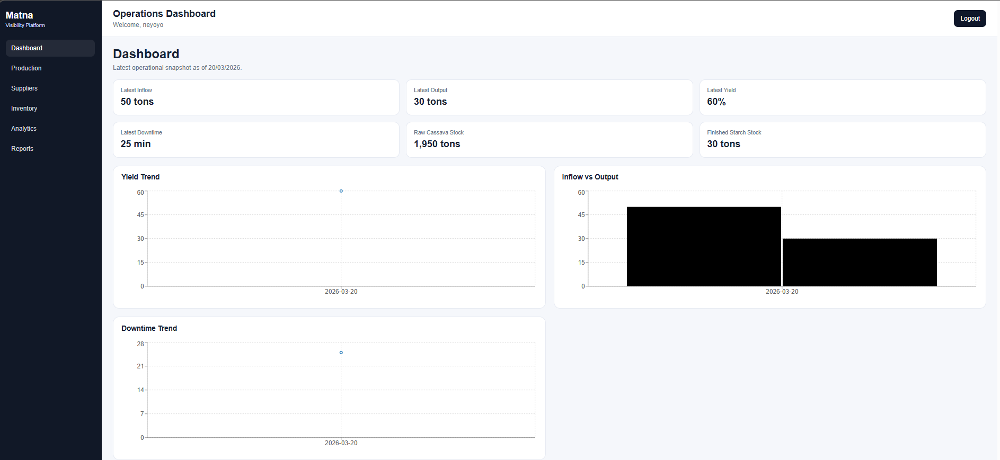
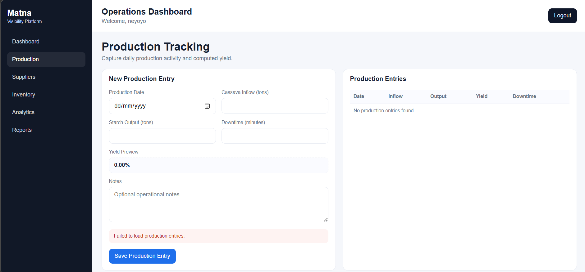
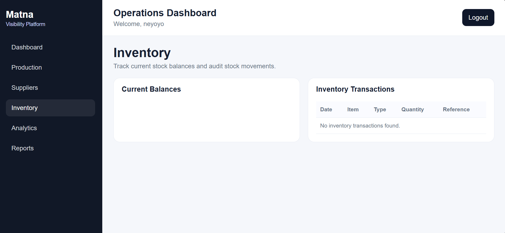
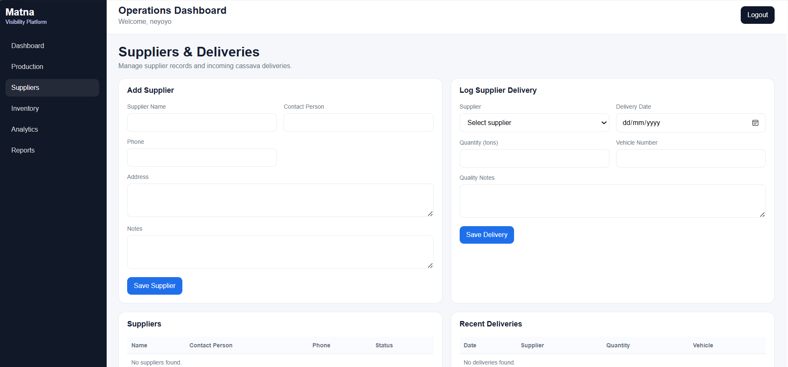
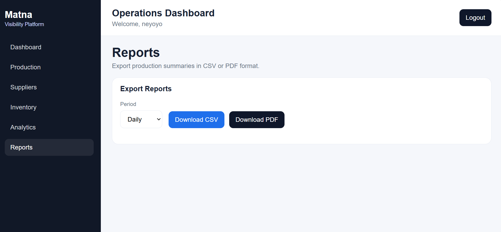

# Matna Visibility Platform 🏭

An advanced, full-stack operational intelligence platform designed to track cassava inflow, starch output, inventory balances, and supplier deliveries for agro-processing environments. Built by **BravEdge Solutions**.

## 🌟 Features

* **Role-Based Access Control (RBAC):** Distinct permissions and dashboards for System Admins, Floor Operators, and Management.
* **Production Tracking:** Log daily cassava inflow, starch output, equipment downtime, and automatically calculate production yield percentages.
* **Automated Inventory Management:** Real-time tracking of raw cassava and finished starch stock. Inventory automatically adjusts based on supplier deliveries and production consumption.
* **Supplier Management:** Maintain a complete supplier registry, track individual deliveries, and record quality control notes.
* **Analytics Dashboard:** Real-time visual metrics, yield trends, and inflow vs. output charts powered by Recharts.
* **Comprehensive Reporting:** Generate and export daily, weekly, or monthly operational summaries in CSV or PDF formats.

## 📸 System Preview

### 🖥️ Analytics Dashboard
The central hub for management to monitor production snapshots, yield efficiency, and downtime KPIs.


### ⚙️ Production Entry
A streamlined interface for floor operators to log daily production metrics without disrupting factory workflows.


### 📦 Inventory Management
Track real-time balances of raw materials and finished goods, alongside a complete transaction history.


### 🚚 Supplier Portal
Manage supplier profiles and track historical delivery volumes.


### 📊 Reports & Exports
Generate management-ready reports for deeper operational insights.



## 🛠️ Tech Stack

**Backend**
* Python 3.10+
* Django 5.0 & Django REST Framework
* PostgreSQL
* Simple JWT (JSON Web Tokens)
* Python Decouple

**Frontend**
* React 18 (Vite)
* Axios (with automated interceptors)
* Recharts (Data Visualization)

**Database:** PostgreSQL
**Deployment:** Gunicorn, Nginx
**DevOps:** Docker, Docker Compose

## 📋 Prerequisites

Before you begin, ensure you have the following installed:
* [Node.js](https://nodejs.org/) (v18.0 or higher required for Vite)
* [Python](https://www.python.org/downloads/) (v3.10 or higher)
* [PostgreSQL](https://www.postgresql.org/) (running locally or via Docker)

---

## 🚀 Local Development Setup

### 1. Database Setup
Create a new PostgreSQL database and dedicated user. You can do this via pgAdmin or the psql CLI:
```sql
CREATE DATABASE matna_visibility;
CREATE USER magna WITH PASSWORD 'magna1234';
ALTER ROLE magna SET client_encoding TO 'utf8';
ALTER ROLE magna SET default_transaction_isolation TO 'read committed';
ALTER ROLE magna SET timezone TO 'UTC';
ALTER DATABASE matna_visibility OWNER TO magna;
```

### 2. Backend Setup
Navigate to the backend directory, set up your virtual environment, and install dependencies.

```bash
cd backend

# Create and activate virtual environment
python -m venv venv
# On Windows: .\venv\Scripts\Activate.ps1
# On Mac/Linux: source venv/bin/activate

# Install requirements
pip install -r requirements/development.txt
```

**Environment Variables**
Create a `.env` file inside the `backend` folder next to `manage.py`:
```env
DEBUG=True
SECRET_KEY=your-secure-generated-secret-key
ALLOWED_HOSTS=127.0.0.1,localhost

DB_NAME=matna_visibility
DB_USER=magna
DB_PASSWORD=magna1234
DB_HOST=127.0.0.1
DB_PORT=5432

CORS_ALLOWED_ORIGINS=http://localhost:5173

JWT_ACCESS_LIFETIME_MINUTES=30
JWT_REFRESH_LIFETIME_DAYS=7
```

**Migrate & Run**
```bash
# Apply database migrations
python manage.py migrate

# Seed the initial inventory items (RAW_CASSAVA, FINISHED_STARCH)
python manage.py seed_inventory

# Create your admin account
python manage.py createsuperuser

# Start the server
python manage.py runserver
```
*The backend API will run on `http://127.0.0.1:8000`*

### 3. Frontend Setup
Open a new terminal window, navigate to the frontend directory, and install dependencies.

```bash
cd frontend

# Install Node modules
npm install

# Set up env file (copy from example)
copy .env.example .env

# Start the development server
npm run dev
```
*The frontend application will run on `http://localhost:5173`*

---

## 🔐 Default API Endpoints

* **Auth (Login):** `/api/auth/login/`
* **Current User:** `/api/auth/me/`
* **Dashboard Analytics:** `/api/analytics/dashboard/`
* **Production Entries:** `/api/production/entries/`
* **Inventory Balances:** `/api/inventory/balances/`

## 📁 Project Structure

```text
matna_visibility_platform/
├── backend/                  # Django API
│   ├── apps/                 # Modular Django apps
│   │   ├── accounts/
│   │   ├── production/
│   │   ├── inventory/
│   │   ├── suppliers/
│   │   └── analytics/
│   ├── common/               # Shared utilities, mixins, and constants
│   ├── config/               # Main Django settings & URLs
│   ├── requirements/         # Environment-specific dependencies
│   └── manage.py
├── frontend/                 # React UI
│   ├── src/
│   │   ├── api/              # Axios configuration & endpoints
│   │   ├── components/       # Reusable UI components
│   │   ├── features/         # Feature-specific logic
│   │   └── app/              # Global state and routing
│   ├── index.html
│   ├── vite.config.js
│   └── package.json
├── docs/screenshots/         # UI Images
├── docker-compose.yml        # Container orchestration
└── README.md
```